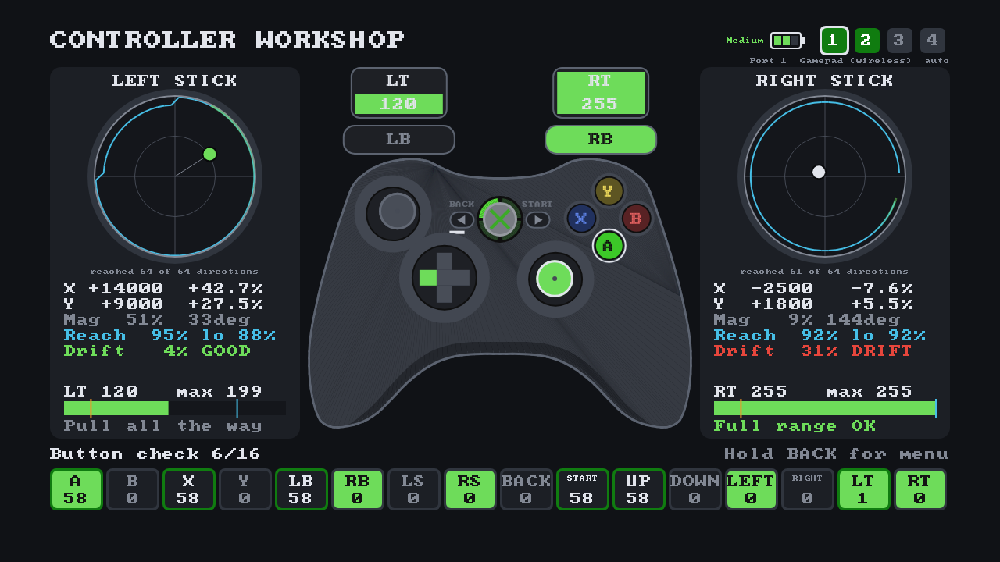
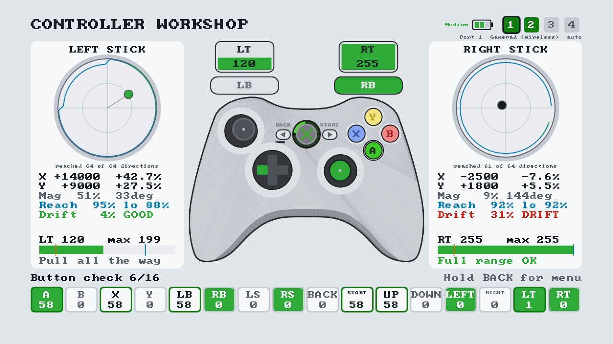
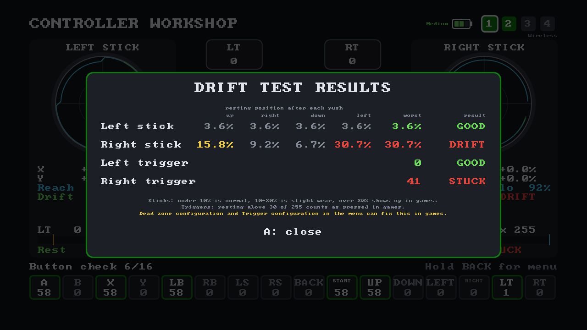
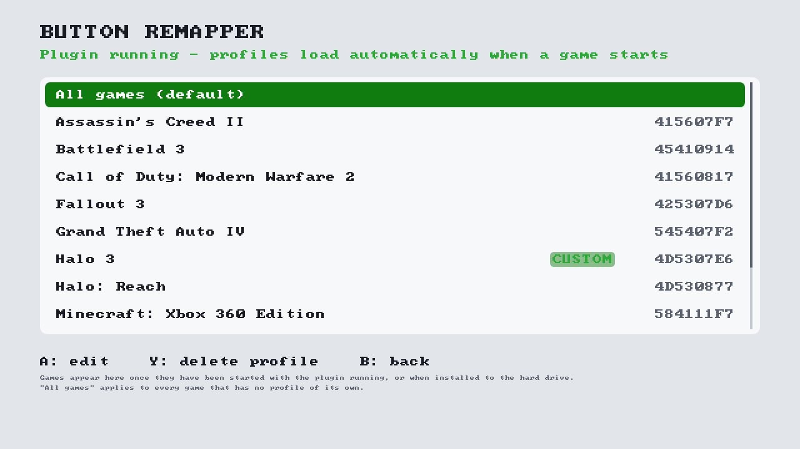
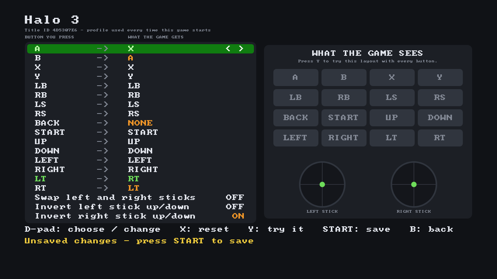
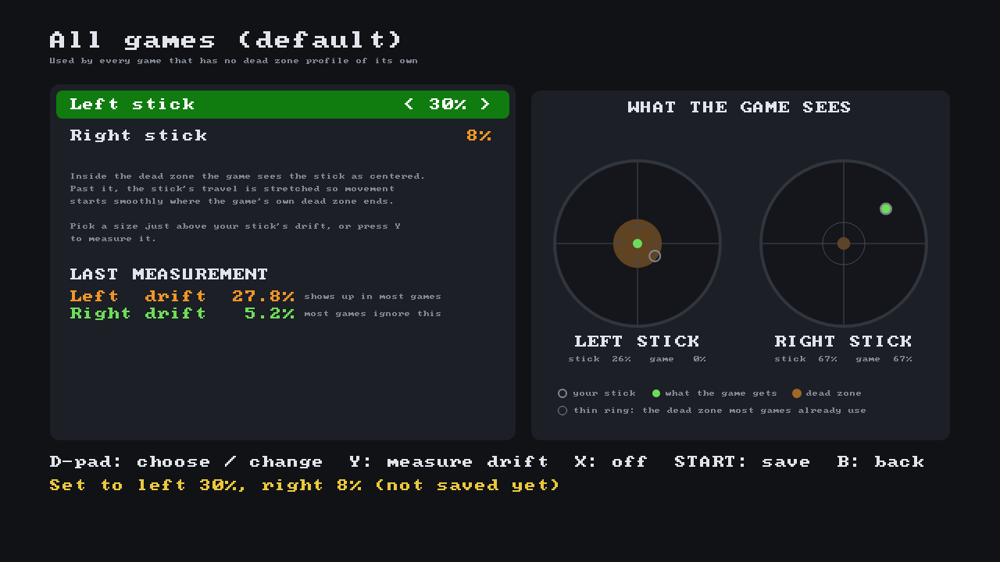

# Controller Workshop

A controller tester, per-game button remapper and stick drift fix for modded (RGH/JTAG) Xbox 360
consoles.

Test every button, stick and trigger on your controller, check for stick drift
and worn-out spots, and try the rumble motors. Then remap buttons or set
stick dead zones for any game. A small DashLaunch plugin applies your settings every time that
game starts.



> The screenshots in this README are rendered on a PC from the app's own drawing code and were
> checked against screenshots taken on a console.

## Features

**Controller tester**
- Live controller picture: buttons, D-pad, bumpers and stick clicks light up; sticks move;
  triggers fill.
- Button check: all 16 inputs turn green once they've worked, with a press count. A button that
  never turns green is broken.
- Stick panels: raw values (-32768..32767) and percentages, a motion trail, and an outline
  of the furthest point reached in 64 directions, which shows worn sticks that can't reach the edge.
- Trigger bars with the highest value reached, so you can spot a trigger that never gets to 255.
- Drift test: put the controller down and it measures how far each stick and trigger rests from
  center, then rates them GOOD / SLIGHT / DRIFT (sticks) and GOOD / STUCK (triggers).
- Rumble test: drive each motor by hand with the triggers.
- Battery level for wireless controllers, up to 4 controllers, and the Guide button's ring of
  light shows which port you're looking at.

**Button remapper**
- Per-game profiles plus an "All games" default.
- Map any button or trigger to any other, or turn it off. Swap the sticks, or invert either
  stick's up/down.
- Try a layout in the app before saving it.
- Applies automatically when the game starts. No need to open the app again.

**Dead zone configuration (drift fix)**
- Stops a drifting stick from moving your character or camera on its own.
- Pick a dead zone size for each stick (1-50%), or let the app measure your drift and pick one.
- Per-game profiles plus an "All games" default, separate from button remaps, so one setting can
  fix a worn stick in every game.
- Applied by the same plugin when the game starts.

**Light and dark themes**

| Dark | Light |
|---|---|
|  |  |

## Requirements

- An RGH or JTAG Xbox 360 that runs unsigned code (dev-kit-signed XEXs, as built by the SDK).
- **DashLaunch** for the button remapper and stick dead zones (the plugin loads through it). The
  tester works without it.

## Install

1. Download `default.xex` and `ControllerWorkshopPlugin.xex` from the
   [Releases](../../releases) page and copy both to **`Hdd:\ControllerWorkshop\`** on the console.
   - `default.xex` is the app.
   - `ControllerWorkshopPlugin.xex` is the plugin that applies remaps and dead zones in games.

   The app can live anywhere (for example `Hdd:\Apps\ControllerWorkshop\`), but its settings and
   profiles always go to `Hdd:\ControllerWorkshop\`.
2. For the remapper and dead zones, add the plugin to DashLaunch's `launch.ini` under `[Plugins]`, in a free
   slot (`plugin1` to `plugin5`), then restart the console:
   ```ini
   [Plugins]
   plugin4 = Hdd:\ControllerWorkshop\ControllerWorkshopPlugin.xex
   ```
3. Start `default.xex` from Aurora, FSD, or XeXMenu. Add it to your Aurora scan paths
   if you want it in your app list.

**Name, icon and Aurora art.** The XEX carries its own name and icon, so Aurora and FSD show "Controller Workshop" with its icon as soon as they scan it. The first time you
start the app from Aurora, it also gives Aurora its cover and background (restart Aurora to see them). It only fills in art Aurora doesn't have yet, so a cover you
picked yourself is never replaced.

### Uninstall
Remove the plugin line from `launch.ini`, restart, and delete `Hdd:\ControllerWorkshop\` (and the
app's own folder, if you put it somewhere else).

## Using the tester

The app opens on the tester so you can start using it right away.

| Screen part | What it shows |
|---|---|
| Controller picture | Buttons, D-pad, bumpers and stick clicks light up while held. Sticks move, triggers fill. |
| Stick panels | Raw X/Y and %, a fading trail, the furthest point reached in each of 64 directions (blue outline), Reach (average and lowest of those directions, 100% = the edge) and the last drift test result. |
| Trigger bars | Live value 0-255, the threshold where games count it as pressed (30, orange mark) and the highest value reached (blue mark). |
| Button check | All 16 inputs. Outlined green once they've worked; the number is the press count. |
| Top right | Battery, connected ports (1-4; the outlined one is shown) and whether it's wireless or wired (plus "locked" when the menu locks a port). By default the screen follows whichever controller was used last. |

**Hold BACK for one second** to open the menu (D-pad to move, A to select, B to close).
Every other button is part of the test, so BACK is the only one that opens the menu. While the
menu or a test is open, presses aren't counted and the tester behind it shows a resting controller.

| Menu item | What it does |
|---|---|
| Controller | **Auto**, or lock to one connected port. Only ports with a connected controller are offered. |
| Rumble test | LT and RT drive the left (heavy) and right (light) motors. B = back. |
| Drift test | Let go of the controller. After a 2-second countdown it measures for 2 seconds and shows the results. |
| Button remapper | See below. |
| Dead zone configuration | See below. |
| Theme | Dark or Light (left/right or A). Remembered between sessions. |
| Reset stats | Clears the button check, press counts, reach outline and drift results for the shown controller. |
| Exit to dashboard | Goes back to the dashboard. |

### Reading the results

- **Stick drift**: run the drift test. Under 10% is normal, 10-20% is slight wear, over 20% will
  show up in games as movement you didn't make. You can also watch the dot: it should come back to
  the middle when you let go. To fix drift in games, use **Dead zone configuration**.
- **Worn sticks**: spin each stick slowly around its edge. The blue outline should be a nearly full
  circle and Reach should read close to 100%. A dent in one direction (a low "lo" %) means the
  stick can't reach the edge there. Reach stops at 100%, even though a stick reports a little more
  in the corners of its square gate.
- **Dead buttons**: press everything once. Anything still gray in the button check didn't register.
- **Triggers**: pull each one all the way. "Full range OK" means it reaches 255. A trigger resting
  above 30 in the drift test is reported as STUCK, because games treat it as held.



## Using the button remapper

Open **Button remapper** from the menu and pick a game, or **All games** to set a default for
every game without its own profile. Games with a profile are marked CUSTOM. In the list, A opens
the editor, Y deletes the selected game's profile (it asks first) and B goes back.



In the editor, the left column is the button you press and the right column is what the game
receives. Changed rows are orange. The **WHAT THE GAME SEES** panel on the right only reacts while
you're trying the layout (Y), so moving through the list doesn't light it up.



Good to know:
- The layout is applied by the plugin every time the game starts. Changes take effect the next
  time you start the game.
- A game's own profile takes priority over **All games**.
- **All games** never applies to the dashboard, Aurora, FSD, XeXMenu or Controller Workshop itself,
  so a bad default can't lock you out of your menus.
- A profile applies to every controller connected while the game runs.
- Saving the normal layout deletes the profile, so the plugin leaves that game alone.
- The Guide button can't be remapped.

**Which games are listed:** every game started while the plugin was running, plus games installed on the hard drive (Games on Demand, Arcade and disc
installs). A game you haven't started since installing the plugin may not be listed yet; start it
once and it will appear.

## Using dead zone configuration

Open **Dead zone configuration** from the menu and pick a game, or **All games** to fix stick drift in
every game without its own dead zone profile. The list works like the remapper's (A: edit,
Y: delete profile, B: back; CUSTOM = has a dead zone profile). Dead zone profiles are separate from
remap profiles, so a game can have its own button layout and still use the All games dead zone.

In the editor, set a size for each stick, or press **Y** to measure the drift. The app asks you to
push both sticks up, right, down and left, letting go after each one, and measures where they come
to rest each time. A worn stick settles in a different spot depending on which way it came back
from, so the worst of the four is used, plus a small margin (2%). The **WHAT
THE GAME SEES** panel is live: the hollow ring is where your stick really is, the green dot is
what the game gets and the orange disc is the dead zone. The thin ring is the dead zone most games
already use on their own (about 24-27%); drift inside it usually doesn't show up in games anyway.

| Button | Action |
|---|---|
| D-pad up/down | Choose a stick |
| D-pad left/right | Make the dead zone smaller or bigger (OFF, 1-50%) |
| Y | Measure drift: push both sticks each way as asked and let go; both sticks are set from the result (B cancels) |
| X | Turn both dead zones off |
| START | Save |
| B | Back (asks first if you have unsaved changes) |



Good to know:
- Past the dead zone, the rest of the stick's travel is stretched so the movement starts right
  where the game's own dead zone ends. You don't lose fine aim, and the two dead zones don't add
  up. A dead zone smaller than the game's own changes nothing in most games.
- Dead zones are applied to the physical sticks before any remapping, so they follow the stick
  if you also swap the sticks.
- Like remaps: applied when the game starts, a game's own profile beats **All games**, **All
  games** never applies to dashboards, Aurora, FSD, XeXMenu or Controller Workshop (so the tester
  always shows your real stick), and a profile applies to every connected controller.
- Setting both sticks to OFF and saving deletes the profile.

## Troubleshooting

- **The remapper says "Plugin not running".** Check the `launch.ini` line points to
  `Hdd:\ControllerWorkshop\ControllerWorkshopPlugin.xex` and that you restarted the console. If
  `Hdd:\ControllerWorkshop\plugin.log` doesn't exist, the plugin didn't load.
- **A remap or dead zone doesn't work in a game.** Look in `plugin.log`. For each game it logs the
  title ID, the name, which remap and dead zone profiles it used (with both dead zone sizes), and
  either "remap active" or why it gave up. The plugin changes
  input that games read through the standard XInput function. A game that reads the controller
  another way won't be affected.
- **The plugin conflicts with another plugin.** Controller Workshop's plugin loads at memory
  address 0x91E80000-0x91EB2000. If another plugin uses that range, one of them won't load.
- **No cover or background in Aurora.** Start the app once from Aurora, then restart Aurora. The app
  looks for Aurora's `Data\GameData` folder up to two folders deep on the hard drive (for example
  `Hdd:\Aurora` or `Hdd:\Apps\Aurora`); an Aurora installed on a USB drive isn't covered.

## Known limitations

- The Guide button can't be tested or remapped; the system keeps it for itself.
- Remap and dead zone profiles apply to all connected controllers, not per controller.
- Remap and dead zone changes apply the next time the game starts.
- A dead zone only covers the sticks; the triggers keep their normal behavior.

## AI disclosure

This is an AI-assisted project. Much of the code, tooling and documentation was written with
the help of Claude, under the author's direction. The author
reviewed the changes and tested them on a real Xbox 360.

## Credits

- 8x8 font: [font8x8](https://github.com/dhepper/font8x8) by Daniel Hepper (public domain),
  based on the IBM PC BIOS font.
- Xbox 360 internals (xam ordinals, SPA/XDBF layout, loader structures) from the
  [Xenia](https://github.com/xenia-project/xenia) project's research, and the device-stats layout
  from the community `xkelib` headers.

## License

[MIT](LICENSE).
